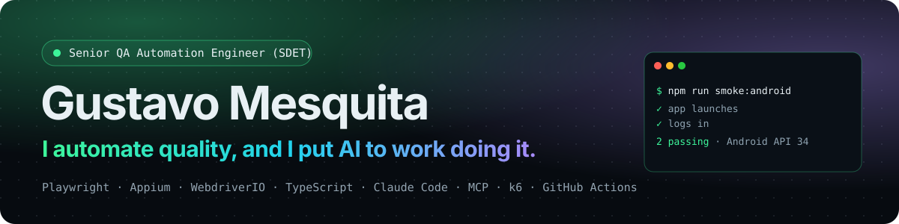

  
  
  

**Senior QA Automation Engineer (SDET)** · 9+ years in QA · Brazil (remote, overlap with US/EU hours)

I build test automation that people trust: Playwright + TypeScript suites, mobile automation with Appium on Android and iOS,
CI/CD pipelines, performance checks and AI-driven testing workflows, always with a human reviewing before merge.

## What I work on

- **E2E and API automation:** Playwright (primary), Appium + WebdriverIO, Cypress, Maestro, RestAssured (Java)
- **Mobile:** native Android/iOS from one Screen Object layer, deep-link test setup, gestures, NATIVE ↔ WEBVIEW, mocked GPS, interruptions, mobile web on a real Android Chrome
- **AI-driven testing:** Playwright MCP and Appium MCP for exploration, Claude Code skills for test generation and evidence-first CI failure triage
- **Performance:** k6 browser tests with Core Web Vitals gates
- **CI/CD and reporting:** GitHub Actions, Android emulators in CI, Allure and Playwright reports on GitHub Pages, Slack notifications

## Featured projects

| Project | What it shows | CI | Live report |
| --- | --- | --- | --- |
| [**playwright-typescript-e2e-framework**](https://github.com/gustavaom7/playwright-typescript-e2e-framework) | Page Objects, fixtures, cross-browser + mobile emulation, a11y, visual regression, MCP test generation, k6, automated defect triage |  | [HTML report](https://gustavaom7.github.io/playwright-typescript-e2e-framework/) |
| [**appium-mobile-e2e-framework**](https://github.com/gustavaom7/appium-mobile-e2e-framework) | Appium 3 + WebdriverIO 10 + TypeScript: one codebase for Android and iOS, deep-link setup, gestures, NATIVE ↔ WEBVIEW, mocked GPS, background/screen-lock interruptions, mobile web in the emulator's real Chrome, Allure with video on failure, Appium MCP + skills for screen generation and CI triage, flaky failures traced to root cause with logcat |  | [Allure report](https://gustavaom7.github.io/appium-mobile-e2e-framework/) |
| [maestro-mobile-ai-qa](https://github.com/gustavaom7/maestro-mobile-ai-qa) | Mobile flows with Maestro, CI, Slack reporting and an LLM test generator |  | |
| [cypress-hybrid-suite](https://github.com/gustavaom7/cypress-hybrid-suite) | Cypress GUI + API suite: cy.session, intercept mocking, visual diff, k6 and Lighthouse |  | [Mochawesome report](https://gustavaom7.github.io/cypress-hybrid-suite/full-report.html) |
| [api-testing-restassured](https://github.com/gustavaom7/api-testing-restassured) | Java API testing with RestAssured + JUnit 5: smoke, JSON-schema contract and input-handling checks |  | [Allure report](https://gustavaom7.github.io/api-testing-restassured/) |
| [xcuitest-ios-automation](https://github.com/gustavaom7/xcuitest-ios-automation) | Native iOS UI automation in Swift + XCUITest: Page Objects, 19 tests, XcodeGen, macOS CI |  | |
| [gustavaom7.github.io](https://github.com/gustavaom7/gustavaom7.github.io) | My portfolio, tested with its own Playwright + axe-core suite and Lighthouse CI |  | [Site](https://gustavaom7.github.io/) |

## Stack

## Contact

[Portfolio](https://gustavaom7.github.io/) · [LinkedIn](https://www.linkedin.com/in/qa-gustavo-mesquita/)
